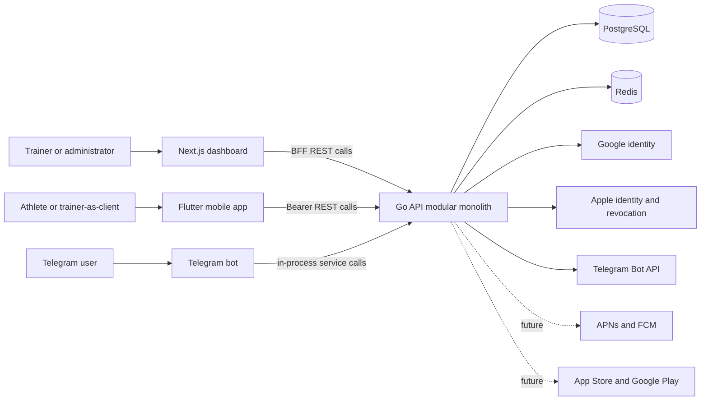
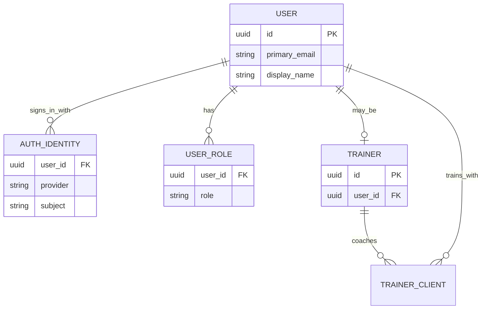
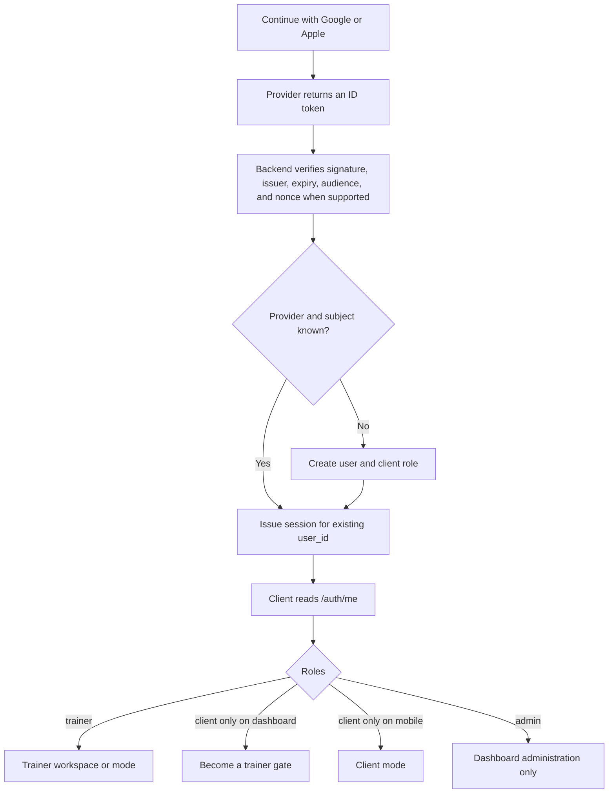
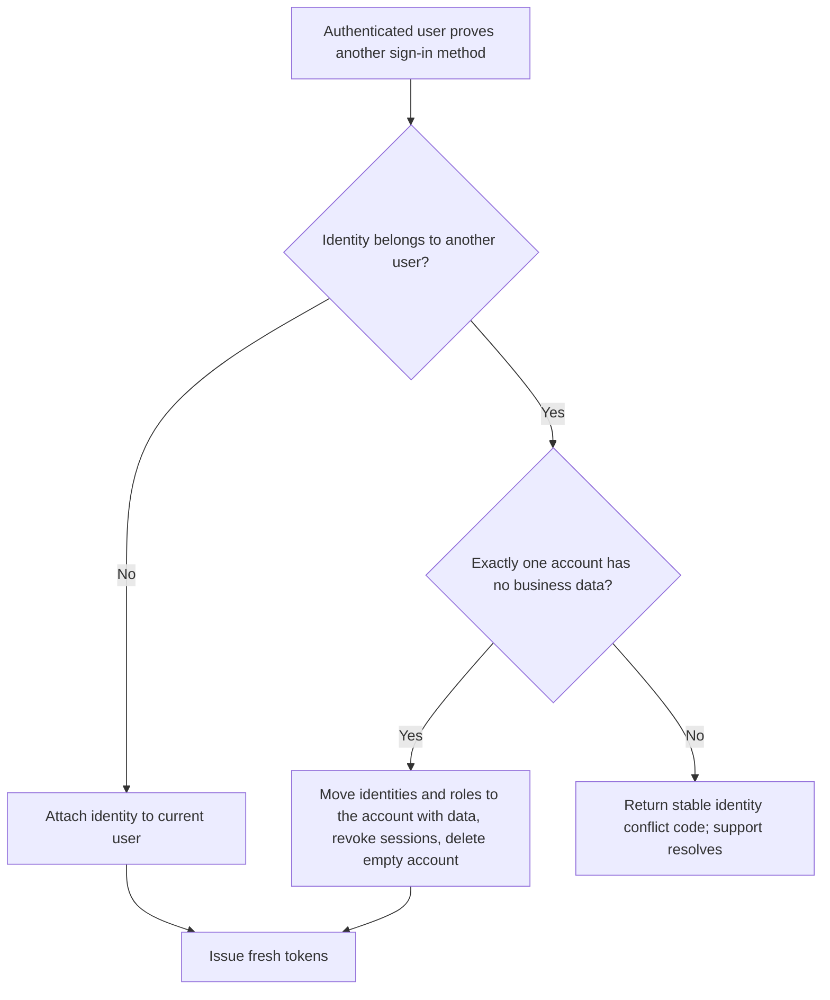

# Mentorix Platform Architecture

> **Owner:** Mentorix product owner  
> **Last updated:** 2026-10-18  
> **Scope:** `backend`, `dashboard`, `mobile`, and the Telegram bot embedded in `backend`  
> **Environment:** Render stage is the only deployed environment and currently hosts the pilot data.

## Status legend

| Status                        | Meaning                                                                                                                                                                     |
| ----------------------------- | --------------------------------------------------------------------------------------------------------------------------------------------------------------------------- |
| **Implemented on stage**      | Present in the checked-out code and documented for the Render stage deployment. Merge status in each repository's `main` branch must be confirmed by that repository owner. |
| **Approved direction**        | Agreed platform design that is not fully implemented yet.                                                                                                                   |
| **Deferred**                  | Deliberately postponed until its stated trigger occurs.                                                                                                                     |
| **Future goal**               | Kept as target architecture, but explicitly excluded from the current phase and not built yet.                                                                              |
| **Open implementation check** | Direction is agreed, but an external console or runtime check is still required.                                                                                            |

This document separates verified current behaviour from approved target-state decisions. The API contract remains [`backend/api/openapi.yaml`](../backend/api/openapi.yaml); this document does not replace it.

## 1. Product goal

Mentorix is one platform connecting trainers and athletes:

- trainers need a professional tool to manage clients, exercises, programs, progress, and feedback;
- clients need a convenient mobile experience for discovering trainers and programs, following workouts, recording results, and communicating progress;
- administrators need web tools for moderation, user support, subscriptions, and platform operations;
- connecting trainers and clients through public profiles, search, and join requests is a growth layer built after the core training workflow is reliable.

The platform must support a person who is both a trainer and a client of another trainer without creating separate identities.

## 2. Architecture principles

1. **One person, one internal account.** `user_id` is the stable identity; Google, Apple, and Telegram are sign-in methods attached to it.
2. **Roles belong to the account, not the application.** Dashboard and mobile render capabilities from server-issued roles.
3. **The backend is authoritative.** Clients never grant roles, merge users, enforce quotas, or decide ownership locally.
4. **OpenAPI is the client contract.** Changes are additive wherever possible; mobile release compatibility is considered before an endpoint changes.
5. **Keep the modular monolith.** New business capabilities become bounded backend modules before a microservice is considered.
6. **Telegram and REST are adapters over the same domain services.** Business rules must not be duplicated in the bot.
7. **No automatic account merge by email.** Email can be absent, unverified, changed, or hidden by Apple.
8. **Prefer staged, reversible delivery.** Do not implement future scale before a concrete feature requires it, but preserve the foundations listed in section 11.

## 3. System context

### Current deployment

- **Implemented on stage:** Go API, PostgreSQL, and Redis run on Render; the dashboard is also on Render.
- **Implemented on stage:** the backend is a single Go deployment containing REST routes, Telegram webhook handling, and best-effort Telegram push workers.
- **Approved direction:** keep stage as the pilot environment. A separate production environment and data cutover are deferred until the pilot proves the product.

## 4. Repository responsibilities

### `backend`

**Current responsibility**

- authoritative identity, role, session, ownership, quota, and authorization rules;
- REST API implemented with Echo and described by OpenAPI;
- PostgreSQL persistence and Redis-backed transient state/rate limits;
- trainer exercises, programs and versions, assignments, analytics, comments, invitations, subscriptions, and client account deletion;
- Telegram bot and outgoing Telegram notifications.

**Target responsibility**

- all shared domain logic used by dashboard, mobile, and Telegram;
- client REST resources for programs, workouts, structured results, comments, preferences, and analytics;
- trainer role activation, account linking, trainer deletion, push devices, store billing adapters, moderation, search, and audit records;
- durable background jobs when in-process delivery is no longer sufficient.

### `dashboard`

**Current responsibility**

- web interface for trainers and administrators (three administrator accounts on stage);
- server-side BFF that keeps access and refresh tokens inside an encrypted, HttpOnly Next.js session;
- exercise, program, client, feedback, and analytics workflows;
- public signed-link client statistics page.

**Target responsibility**

- one Google/Apple entry point for sign-in and sign-up;
- trainer activation gate, administration, moderation, support, and richer analytics;
- full professional editing experience for programs and exercises;
- account settings, sign-in methods, billing management, and account deletion;
- optional authenticated WebView destination for complex trainer tools opened from mobile.

### `mobile`

**Current responsibility**

- Google and Apple sign-in, refresh token rotation, secure token storage, Telegram linking, trainer invitation acceptance, and trainer-list lookup;
- client account deletion through `DELETE /auth/me`. Apple authorization revocation is implemented on the backend but disabled until the Apple private key is configured in Render (until then Apple-linked accounts receive `503 provider_not_configured`), and deletion with revocation has not yet been verified on a device;
- client onboarding shell; the training home is still a placeholder.

**Target responsibility**

- primary athlete experience: trainer and program discovery, assigned workouts, timers, structured results, personal records, achievements, preferences, feedback, and push notifications;
- frequent trainer workflows: clients, feedback, analytics, exercise management, and program management;
- role-aware mode switching for users who are both trainers and clients;
- use a secure dashboard handoff for complex editing until a native editor is justified.

### Telegram bot

- remains a first-class client channel, not a legacy identity system;
- currently handles invitations, program viewing, workout completion, trainer selection, linking codes, and client notifications;
- may later notify a trainer whose Mentorix account has a linked Telegram identity and who has started the bot;
- notification channel preferences must be stored per user when mobile push is introduced.

## 5. Identity and role model

### Canonical model

- **Implemented on stage:** `(provider, subject)` uniquely identifies an authentication identity.
- **Implemented on stage:** `trainer` and `client` roles may coexist. `admin` is exclusive through a database constraint.
- **Implemented on stage:** provider sign-in creates a `client` account when its identity is unknown.
- **Approved direction:** roles themselves do not make an account "non-empty" for merge decisions; owned or related business data does.

### Application behaviour by role

| Roles returned by `/auth/me` | Dashboard                          | Mobile                                                       |
| ---------------------------- | ---------------------------------- | ------------------------------------------------------------ |
| `client`                     | Show the **Become a trainer** gate | Client mode                                                  |
| `trainer`                    | Trainer workspace                  | Trainer mode; link to the dashboard until native tools exist |
| `client`, `trainer`          | Trainer workspace                  | Switch between client and trainer modes                      |
| `admin`                      | Administration workspace           | Explain that administration is web-only                      |

The client never assigns a role based on which application was opened.

## 6. Authentication flow

Google and Apple use the same conceptual entry point in dashboard and mobile. Social sign-in is also sign-up: the backend either finds an identity or creates an account.

### Become a trainer

**Approved direction:** when a client account opens the dashboard, `/auth/me` has no `trainer` role. The dashboard displays terms and an explicit confirmation. On confirmation, the backend atomically:

1. verifies the authenticated user still exists and is not an administrator;
2. creates the trainer profile if absent;
3. grants the `trainer` role without removing `client`;
4. stores the accepted terms version and timestamp;
5. returns the updated profile.

The operation must be idempotent. The final path and schema are **proposed**, not part of the current OpenAPI contract.

Trainer activation ships together with deletion of trainer accounts that have no business data (section 9.1). Otherwise a user who presses **Become a trainer** in the browser could no longer delete the account in the mobile app, which App Store review does not accept.

### Dashboard session

- The dashboard BFF receives provider credentials server-side and stores the Mentorix refresh token only inside the encrypted HttpOnly session.
- Browser code must not receive the backend refresh token.
- BFF requests attach the access token, proactively refresh it, and replay one failed request after refresh.
- Social sign-in returns the refresh token in the JSON body, so the BFF must consume body-mode sessions instead of requiring the backend cookie mode.

### Google on dashboard

**Approved direction:** use Google Identity Services with the existing web client ID. Add the dashboard origin to Authorized JavaScript origins. Send the returned ID token to `POST /auth/google`.

### Apple on dashboard

**Approved direction:** create a separate Services ID such as `com.mentorix.dashboard` under the same Apple Developer Team as the mobile app. Apple's user identifier (`sub`) is scoped to the team, not to a bundle ID or Services ID, so the dashboard resolves to the same Mentorix account as iOS and Android. Only the audience (`aud`) differs, and the backend accepts it through `APPLE_CLIENT_IDS`. Add the new Services ID there on Render.

1. Register the dashboard domain and `https://<dashboard>/api/auth/apple/callback` Return URL in Apple Developer.
2. Host Apple's domain-association file from the dashboard when requested by Apple.
3. Start authorization with `response_type=code id_token`, `response_mode=form_post`, `scope=name email`, and fresh `state` and `nonce`.
4. Store state in a short-lived `Secure; HttpOnly; SameSite=None` cookie because Apple returns a cross-site form POST.
5. The callback verifies state and nonce, extracts the optional first-authorization name, calls `POST /auth/apple`, creates the encrypted dashboard session, and redirects to the application.
6. Do not log the form body, token, code, state, or client secret.

**Open implementation check:** Apple must accept the Render `onrender.com` stage domain. Apple does not support `localhost`; use an HTTPS development tunnel.

## 7. Account linking and conflict rules

### Invariant

One person may attach Google, Apple, and Telegram to one `user_id`. The user must prove control of both the current session and the new identity.

### Merge algorithm

- Never merge based only on matching email.
- "Empty" means no trainer/client relationships, programs, exercises, assignments, workout history, payments, moderation records, or other owned business data. Roles alone do not count as data.
- Merge in one database transaction and lock both users in deterministic ID order.
- Revoke every session of the removed account and issue tokens for the surviving `user_id`.
- Never allow removal of the final usable sign-in method.
- **Future goal (not in P1 or P1b):** record an audit event and notify the user after a merge. Mentorix has no email or push channel to notify through yet.

### Current Telegram behaviour

**Implemented on stage:** Telegram linking already follows a narrower version of this model. An empty social client account can be absorbed into the existing Telegram account. Both accounts with data produce a stable conflict.

### Google versus Apple duplicates

**Approved direction, phase P1b (immediately after P1, before public launch):** dashboard and mobile settings expose **Sign-in methods** so a signed-in user can prove and attach another provider under the rules above. Until P1b ships, a person who uses Google on one surface and Apple on another has two accounts, and support resolves such duplicates manually. Manual resolution is acceptable only during the pilot.

## 8. Existing trainer and administrator migration

Password sign-in exists for nine stage accounts: six trainers and three administrators. That is few enough that no permanent password-claim flow will be built; a one-off migration script moves each account instead.

### Procedure

1. Deploy Google and Apple dashboard sign-in while keeping password login available.
2. Disable new password registration.
3. Each of the nine people signs in once with Google or Apple, which creates a temporary empty client account.
4. Back up the stage database and verify that the backup restores (for example into a separate database) before the first real run.
5. Migrate the accounts with the script, one account at a time (see the script rules below).
6. Verify that each migrated person signs in with Google or Apple and sees the expected dashboard data.
7. After all nine accounts are verified, disable password login, then remove password UI and backend code in a later cleanup.

### Migration script rules

- **Explicit input.** Every run names the source (temporary) `user_id` and the destination (existing password) `user_id`. The script never searches for or guesses pairs, for example by email.
- **Dry run.** A dry-run mode changes nothing and reports exactly what a real run would move and delete.
- **Safe refusal.** If the temporary account has any business data under the section 7 rule, the script changes nothing and reports the reason.
- **One transaction.** A real run locks both users, moves the provider identity to the destination, preserves the destination's roles and trainer data, revokes the temporary account's sessions, and deletes the temporary account.
- **Output.** The script prints a result report that contains no secrets or tokens.
- **Operator.** The backend owner runs the script, one account at a time: dry run first, then the real run, then step 6 for that account.

### Administrators

The three administrator accounts keep the exclusive `admin` role, assigned manually by `user_id` in the database. They follow the same migration procedure.

## 9. Trainer account deletion

**Implemented on stage:** `DELETE /auth/me` deletes client accounts only. Accounts with the `trainer` or `admin` role receive `409 account_deletion_unavailable`.

### 9.1 P1: deleting a trainer account without data

**Approved direction (P1, ships together with Become a trainer):** `DELETE /auth/me` deletes a trainer account exactly like a client account when the account has no business data under the section 7 rule. The trainer profile, the `trainer` role, and its plan entitlement rows are removed with the account. Store-paid entitlements count as payment data and keep the account on the refusal path.

- Trainers with business data still receive `409 account_deletion_unavailable` until section 9.2 ships.
- Administrators always receive `409 account_deletion_unavailable`.
- The existing Apple revocation rules for client deletion apply unchanged.

### 9.2 Later: full trainer deletion

**Approved direction (later):** trainers with clients, programs, and exercises must be able to delete their accounts before trainer functionality is submitted to mobile stores. The workflow must also be available from the dashboard.

1. Require an explicit consequence confirmation, and recent re-authentication once that security goal is built (section 14).
2. Explain that deleting Mentorix does not cancel an App Store or Google Play subscription; link to store cancellation first.
3. Notify linked clients and remove active trainer-client assignments and relationships.
4. Preserve client-owned workout history where legally and technically appropriate, replacing the trainer identity with an anonymized snapshot. The privacy policy and product owner must approve the exact retention rule before implementation.
5. Delete trainer-owned exercises, programs and versions, entitlements, pending invites, trainer profile data, sign-in identities, and sessions in a documented transaction order.
6. Revoke Apple authorization before deletion when an Apple identity exists, using the existing client-deletion mechanism.
7. Remove transient Telegram and Redis state and stop future notifications.
8. Retain only the minimum deletion audit record allowed by the privacy policy; never retain authentication secrets.
9. Document how long deleted data can remain in backups.

Whether deletion is immediate or has a short recovery window remains an implementation/legal decision. The user-facing promise and backend behaviour must match.

## 10. Notifications

### Current

- Telegram notifications go to clients for assignments, program updates, and trainer comments.
- Notification work is held by an in-process queue of 256 jobs; a full queue drops a notification.

### Target

- Define domain events independent of delivery channel, such as workout completed, feedback received, program assigned, and comment added.
- Store user notification preferences by event and channel.
- A trainer with a linked Telegram identity who has started the bot may receive trainer notifications.
- Mobile registers APNs/FCM device tokens per installation.
- Move delivery to a durable worker/queue before notification volume or store webhooks make in-process loss unacceptable.
- Delivery is best-effort; the source of truth remains the in-app activity feed.

## 11. Foundation for future features

### Structured workout results

Before building the client workout API, replace free-text-only completion data with a structured model that supports:

- sets, repetitions, weight, duration, distance, rest time, perceived effort, and optional notes;
- timer prescriptions in exercises/program blocks;
- client-generated operation IDs for idempotent retries and offline synchronization;
- personal records, achievements, and reliable analytics;
- schema evolution across both editable programs and frozen program versions.

Free text remains an optional note, not the sole result representation.

### Content discovery and moderation

Add public visibility and moderation independently of ownership:

- trainer profile and credentials;
- exercise/program visibility (`private`, `unlisted`, `public`);
- moderation states (`draft`, `pending`, `approved`, `rejected`, `suspended`);
- immutable moderation and administrator audit records;
- trainer search, program search, and client join requests in addition to invitations;
- PostgreSQL full-text search first; introduce a search service only when measured needs exceed it.

### Administrative permissions

The current exclusive administrator role, assigned manually to three stage accounts, is adequate for the pilot. Before adding support staff:

- separate permissions such as moderation, support, billing, and user suspension;
- introduce account status and suspension reason independently from roles;
- require an audit reason for sensitive actions;
- keep authorization on the backend, with dashboard controls reflecting server capabilities.

### Billing

- Existing trainer entitlements remain the source of trainer plan permissions.
- Store adapters and webhook processing become a dedicated billing module.
- Paid public programs require a separate purchase/access model; do not overload trainer subscriptions.
- Verify App Store and Google Play rules before designing checkout outside the stores.

### API and mobile compatibility

- Prefer additive response fields and new endpoints.
- Use stable error codes.
- Publish a minimum supported mobile version before compatibility-breaking changes.
- Use feature flags/remote configuration for staged rollout where rollback matters.
- Split growing backend packages by business capability before considering microservices.
- Replace language-specific columns such as `name_ru` with a translation model only when a third language is planned.

### Workspaces

**Deferred:** do not introduce SaaS workspaces now. `trainers.id` is the current tenancy/ownership boundary and clients may belong to multiple trainers. Revisit organizations/workspaces only when a concrete need exists for assistants, gyms, shared billing, or multiple trainers managing the same catalog.

## 12. Delivery roadmap

| Phase | Outcome | Main work |
| --- | --- | --- |
| **P1: Unified identity and dashboard sign-in** | One social identity works on both surfaces | Become-a-trainer operation, deletion of trainer accounts without data, dashboard Google/Apple, nonce, body-mode BFF session, migration script, password retirement |
| **P1b: Sign-in methods** | A person attaches Google and Apple to one account without support | Provider-link API with merge and conflict rules (section 7), Sign-in methods screens in dashboard and mobile, last-method protection. Required before public launch |
| **P2: Athlete product** | Mobile replaces the bot as a complete athlete interface while the bot remains supported | Structured workout model, client REST API, offline/idempotent sync, mobile push, activity feed, records and timers foundation |
| **P3: Trainer mobility** | Trainers handle frequent work on phones | Client list, feedback, analytics, exercise/program actions, Telegram/push alerts, secure dashboard handoff for complex editing, full trainer deletion before trainer features reach the stores |
| **P4: Growth and commerce** | Mentorix connects and monetizes both sides | Store billing/webhooks, moderation, public profiles, discovery/search, production environment and real domain |

P1 and the model design of P2 may proceed in parallel. P1b follows P1 directly; until it ships, support resolves Google/Apple duplicates manually, and only during the pilot. Public discovery must not block core training reliability.

## 13. Environments and domains

- Render stage is the only current environment and contains pilot data.
- Keep secrets only in Render environment settings; client IDs are configuration, private keys are secrets.
- Before public store/TestFlight distribution, acquire the real domain and configure:
  - Apple web Services ID and Return URL;
  - public Terms and Privacy pages;
  - production API/dashboard/mobile configuration.
- Treat any Telegram linking code as a bearer secret: single-use, short-lived, and never logged.
- When a separate production environment is introduced, define an explicit stage-data decision: migrate selected pilot users or start production clean. Never silently point pilot clients at an empty database.

## 14. Security baseline

### Current phase (P1 and ongoing)

- Verify provider signature, issuer, expiry, audience, and state. **Nonce verification is added in P1.**
- Rotate refresh tokens on every refresh.
- Before public launch, rate-limit by a combination of IP, provider subject/account, and operation; IP-only limits harm carrier-NAT users.
- Revoke sessions after account merge, password retirement, suspension, and deletion.
- Never log ID tokens, authorization codes, refresh tokens, link codes, or Apple form bodies.
- Keep manual database assignment of the three administrators until support staff or more operators require a controlled admin-management flow.
- Maintain a tested administrative merge tool before user volume makes manual SQL support unsafe.

### Future goals (not in P1)

These items stay in the target architecture but are not built now. A previous implementation was rolled back as too complex for the pilot, and Mentorix has no email or push channel to deliver security notifications yet.

- Track refresh-token families and detect reuse of an already-rotated token.
- Require recent re-authentication before linking, role elevation, billing, and account deletion.
- Audit identity links/merges, role changes, moderation, support access, and deletion.
- Notify the user after an account merge or a new sign-in method.

Revisit them when an email or push channel exists and the pilot identity flows are stable.

## 15. Per-repository action list

### Backend

| Priority | Action |
| --- | --- |
| P1 | Add idempotent trainer activation with versioned terms acceptance. |
| P1 | Let `DELETE /auth/me` delete trainer accounts without business data like client accounts (section 9.1); ship it together with trainer activation. |
| P1 | Accept dashboard Google/Apple sessions and verify nonce. |
| P1 | Change merge emptiness from role-based to business-data-based checks. |
| P1 | Write the one-off migration script with explicit input, dry run, and safe refusal (section 8); the backend owner runs it one account at a time after a verified backup. |
| P1 | Disable password registration, verify all nine migrated accounts, then disable password login and schedule code removal. |
| P1b | Add the provider-link API with merge rules, stable identity-link conflict codes, and last-method protection. |
| P2 | Design structured workout prescriptions/results before exposing the client workout API. |
| P2 | Add client program, workout, comment, activity, preference, and push-device APIs to OpenAPI. |
| P3 | Emit channel-neutral domain events and move delivery to a durable worker when volume requires it. |
| P3 | Add full trainer deletion (section 9.2) before trainer features reach the stores. |
| P4 | Add store billing/webhooks, moderation, public profiles, search, and join requests. |

### Dashboard

| Priority | Action                                                                                                                                          |
| -------- | ----------------------------------------------------------------------------------------------------------------------------------------------- |
| P1       | Replace separate email sign-in/sign-up entry points with Google and Apple continuation buttons while retaining password login during migration. |
| P1       | Consume body-mode refresh tokens in the BFF, implement Apple `form_post`, and keep provider credentials out of browser storage and logs.        |
| P1       | Add the role-driven **Become a trainer** gate and render dashboard mode from `/auth/me`.                                                        |
| P1       | Remove registration, forgot-password, and password-login UI after migration verification.                                                       |
| P1       | Publish reviewed Terms and Privacy pages and expose their version to the trainer-activation flow.                                               |
| P1b      | Add the **Sign-in methods** settings screen for attaching Google and Apple to the current account.                                              |
| P3       | Add a short-lived, allowlisted handoff endpoint for complex trainer tools opened from mobile.                                                   |
| P3       | Expose full trainer deletion (section 9.2) in account settings.                                                                                 |
| P4       | Add billing, moderation, support, and public profile management.                                                                               |

### Mobile

| Priority | Action                                                                                                          |
| -------- | --------------------------------------------------------------------------------------------------------------- |
| P1       | Render mode from `/auth/me`; do not infer trainer/client identity from the selected provider or app.            |
| P1b      | Add the **Sign-in methods** settings screen for attaching Google and Apple to the current account.              |
| P2       | Implement structured, idempotent and offline-tolerant client workout flows plus activity and push preferences.  |
| P3       | Add role switching and frequent native trainer workflows, using secure dashboard handoff for complex editing.   |
| P4       | Add store purchases only after billing contracts, deletion, Terms, Privacy, and store disclosures are complete. |

## 16. Deferred decisions and open checks

| Item                                | Status                          | Trigger / required evidence                                                                                                                                         |
| ----------------------------------- | ------------------------------- | ------------------------------------------------------------------------------------------------------------------------------------------------------------------- |
| Email-code sign-in                  | Deferred option                 | Add only if a required trainer/admin cannot use Google or Apple.                                                                                                    |
| User-managed Google/Apple linking   | Scheduled as P1b; required before public launch | Pilot only: support resolves duplicates manually. Exit: the provider-link flow passes conflict, nonce-replay, last-method, and session-revocation tests.         |
| Security hardening                  | Future goal                     | Refresh-token family reuse detection, recent re-authentication, audit records, and merge notifications (section 14). Revisit when an email or push channel exists. |
| Workspaces/organizations            | Deferred                        | Assistants, gyms, shared catalogs/billing, or multi-trainer ownership become concrete requirements.                                                                 |
| Dedicated search service            | Deferred                        | Measured PostgreSQL full-text search limits justify it.                                                                                                             |
| Microservices                       | Deferred                        | A bounded module has independently measured scaling, deployment, or ownership needs.                                                                                |
| Native complex program builder      | Deferred                        | Mobile usage proves WebView handoff is inadequate.                                                                                                                  |
| Separate production environment     | Deferred after pilot            | Domain, store release, legal operator, cutover scope, backups, and operational ownership are ready.                                                                 |
| Apple Render domain                 | Open implementation check       | Apple Developer accepts the stage domain and Return URL.                                                                                                            |
| Apple identity across surfaces      | Open implementation check       | One test Apple ID signed in on iOS, Android, and dashboard resolves to one `user_id`; a mismatch means the Services ID belongs to a different Apple Developer Team. |
| Main-branch availability            | Open implementation check       | Repository owners confirm which documented stage endpoints are merged to `main`.                                                                                    |
| Apple revocation on deletion        | Open implementation check       | The Apple private key is configured in Render (until then Apple-linked accounts get `503 provider_not_configured`), and deletion with revocation is verified on iOS and Android devices. |
| Self-deletion for trainers with data | Open risk until P3             | From P1 to P3, trainers with business data receive `409 account_deletion_unavailable` in the app. App Store guidance expects deletion to be initiated in the app without contacting support, so section 9.2 must ship before trainer features reach the stores. |
| Hosting region and 30-day retention | Open implementation/legal check | Live Render settings and backend log/backup policies match the Privacy Policy.                                                                                      |
| Trainer-history deletion rule       | Open product/legal check        | Product owner and counsel approve anonymization and retention semantics.                                                                                            |

## 17. Documentation governance

- The product owner owns this file, shares it with the team, and updates it when a platform decision changes.
- Repository documentation remains authoritative for implemented details; this file owns cross-repository target architecture and sequencing.
- Every proposed endpoint or data model must be added to OpenAPI and the owning repository documentation when implemented.
- Update the status legend and relevant section in the same change that promotes an approved direction to implemented.
- Review this document before starting identity, billing, moderation, structured workout, or production-environment work.

## Source map

- Backend platform and deployment: [`backend/docs/architecture.md`](../backend/docs/architecture.md), [`backend/docs/environments.md`](../backend/docs/environments.md)
- Identity and sessions: [`backend/docs/features/auth.md`](../backend/docs/features/auth.md), [`backend/internal/auth/store.go`](../backend/internal/auth/store.go)
- Client deletion: [`backend/docs/features/account-deletion.md`](../backend/docs/features/account-deletion.md)
- Trainer/client relationships: [`backend/docs/features/trainer-invites.md`](../backend/docs/features/trainer-invites.md), [`backend/docs/features/trainer-clients.md`](../backend/docs/features/trainer-clients.md)
- Telegram: [`backend/docs/features/telegram-bot.md`](../backend/docs/features/telegram-bot.md)
- Programs and exercises: [`backend/docs/features/programs.md`](../backend/docs/features/programs.md), [`backend/docs/features/exercises.md`](../backend/docs/features/exercises.md)
- Subscriptions: [`backend/docs/features/subscriptions.md`](../backend/docs/features/subscriptions.md)
- Dashboard session/BFF: [`dashboard/src/entities/auth/server/actions.ts`](../dashboard/src/entities/auth/server/actions.ts), [`dashboard/app/api/bff/[...path]/route.ts`](../dashboard/app/api/bff/%5B...path%5D/route.ts)
- Mobile documentation: [`mobile/README.md`](../mobile/README.md), [`mobile/docs/ROADMAP.md`](../mobile/docs/ROADMAP.md)
