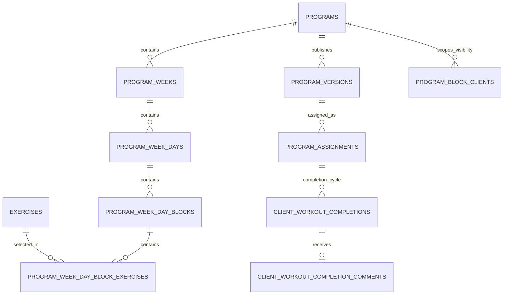

# Mentorix Domain Workflows

> **Owner:** Mentorix product owner  
> **Last updated:** 2026-10-22  
> **Verified against:** `backend` commit `6e8517e5b944a4b763a05ae65862e877870d5ae7`  
> **Scope:** implemented exercise, program, workout-completion, and analytics behaviour across `backend`, `dashboard`, `mobile`, and the Telegram bot

These documents are implementation context for engineers and coding agents. They describe current behaviour and use backend entity names verbatim. They do not replace the API contract in [`backend/api/openapi.yaml`](../../backend/api/openapi.yaml) or the database schema in [`backend/db/schema.sql`](../../backend/db/schema.sql).

## Context routing

| Task                                                                  | Read                                 |
| --------------------------------------------------------------------- | ------------------------------------ |
| Exercise catalog, fields, ownership, validation, or quotas            | [Exercises](exercises.md)            |
| Program builder, blocks, versions, assignments, or exercise placement | [Programs](programs.md)              |
| Workout completions, comments, trainer metrics, or client statistics  | [Analytics](analytics.md)            |
| A change crossing all three domains                                   | This index, then all three documents |

For a narrow task, load only the relevant document. Load [Programs](programs.md) with [Analytics](analytics.md) when changing `day_key`, `block_key`, `program_version_id`, or `completion_cycle_id` semantics.

## Authority and status

Use each source for the concern it owns:

1. [`backend/api/openapi.yaml`](../../backend/api/openapi.yaml) defines the intended external HTTP contract.
2. [`backend/db/schema.sql`](../../backend/db/schema.sql) and migrations define persisted structure and constraints.
3. Backend handlers, services, stores, and queries define implemented runtime behaviour.
4. These workflow documents and repository feature documentation explain those sources.

When these sources disagree, treat the difference as contract drift and document it explicitly; do not silently use one source as a substitute for another.

The status terms **Implemented on stage**, **Approved direction**, **Deferred**, **Future goal**, and **Open implementation check** have the meanings defined in [Platform Architecture](../ARCHITECTURE.md#status-legend). A roadmap item is not runtime evidence.

## Shared terms

| Term             | Backend meaning                                                                                                                               |
| ---------------- | --------------------------------------------------------------------------------------------------------------------------------------------- |
| Working copy     | Editable rows rooted at `programs`, including `program_weeks`, `program_week_days`, blocks, and block exercises.                              |
| Frozen version   | Immutable `program_versions` snapshot and its version tree, created by publish or publish-update.                                             |
| `day_key`        | Stable logical day UUID copied from the working tree into versions. Completions use it across version syncs.                                  |
| `block_key`      | Stable logical block UUID copied into versions. `program_block_clients` uses it so visibility spans working and frozen trees.                 |
| Assignment       | Active `program_assignments` row joining one trainer-client pair to a published program version.                                              |
| Completion cycle | `program_assignments.completion_cycle_id`; scopes one completion per `day_key` and changes when the assigned program changes.                 |
| Global exercise  | `exercises.owner_trainer_id IS NULL`; shared catalog content created by an administrator.                                                     |
| Private exercise | `exercises.owner_trainer_id IS NOT NULL`; visible and writable only within the owner trainer's catalog, while administrators can inspect all. |

## Cross-domain model

The version tree mirrors the working hierarchy but is intentionally omitted from this overview. Its exact tables are documented in [Programs](programs.md).

## Cross-domain invariants

1. Clients consume frozen program versions, never an unpublished working copy.
2. A version sync preserves `completion_cycle_id`; changing the assigned `program_id` creates a new cycle.
3. A completion is unique by `(completion_cycle_id, day_key)`.
4. Exercise prescriptions currently contain only `sets`, `reps`, and `instruction`. Structured performed results are not implemented.
5. Block visibility is keyed by `(program_id, block_key)`, not by a version row ID, and changes without publishing.
6. Analytics derives from `client_workout_completions` and active assignments at request time; there is no analytics aggregate table.

## Source map

- Exercise implementation: [`backend/internal/exercise`](../../backend/internal/exercise), [`backend/docs/features/exercises.md`](../../backend/docs/features/exercises.md)
- Program implementation: [`backend/internal/program`](../../backend/internal/program), [`backend/docs/features/programs.md`](../../backend/docs/features/programs.md)
- Completion and analytics implementation: [`backend/internal/workoutcompletion`](../../backend/internal/workoutcompletion), [`backend/internal/workoutcomment`](../../backend/internal/workoutcomment), [`backend/internal/analytics`](../../backend/internal/analytics)
- Trainer and client surfaces: [`dashboard/src/entities`](../../dashboard/src/entities), [`mobile/lib`](../../mobile/lib), [`backend/internal/telegrambot`](../../backend/internal/telegrambot)
