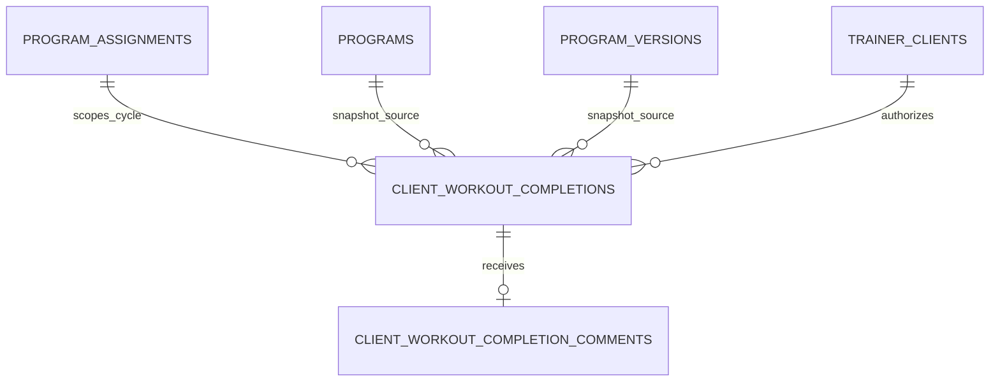
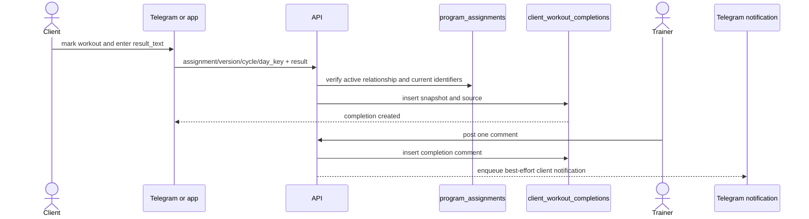
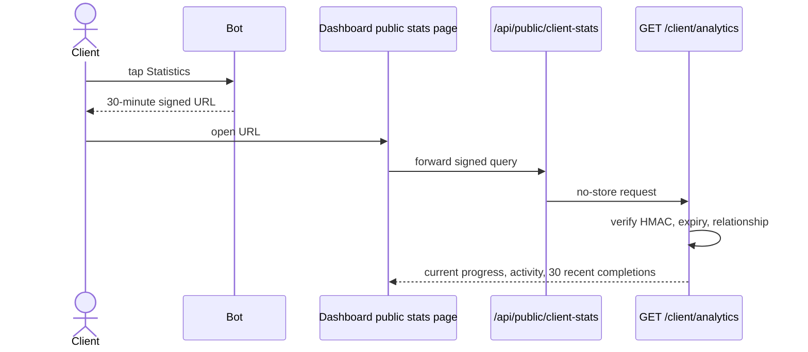

# Workout Completion and Analytics Workflow

> **Owner:** Mentorix product owner  
> **Last updated:** 2026-10-22  
> **Verified against:** `backend` commit `6e8517e5b944a4b763a05ae65862e877870d5ae7`  
> **Use when:** changing workout completion data, trainer/client analytics, comments, progress, streaks, or signed statistics links

**Status: Implemented on stage.** Analytics is read-only projection over the completion journal and active assignments. Metrics are calculated at request time; there is no analytics aggregate table or Redis cache.

## Data model



### `client_workout_completions`

| Column                            | Type and constraint        | API projection                    | Meaning                                                                                                                                                                                                                         |
| --------------------------------- | -------------------------- | --------------------------------- | ------------------------------------------------------------------------------------------------------------------------------------------------------------------------------------------------------------------------------- |
| `id`                              | UUID PK                    | `id`                              | Immutable journal ID.                                                                                                                                                                                                           |
| `client_user_id`                  | UUID FK `users.id`         | scoped identity                   | Client who completed the day.                                                                                                                                                                                                   |
| `trainer_id`                      | UUID FK `trainers.id`      | scoped identity                   | Trainer relationship under which it was completed.                                                                                                                                                                              |
| `completed_at`                    | timestamptz, NOT NULL      | `completed_at`                    | Server-generated UTC completion time.                                                                                                                                                                                           |
| `program_id`                      | nullable UUID FK, SET NULL | `program_id`                      | Program at completion time. Normal program deletion is a soft delete and leaves this value intact; it becomes null only if the program row is physically deleted.                                                               |
| `program_version_id`              | nullable UUID FK, SET NULL | indirect                          | Frozen version seen by the client.                                                                                                                                                                                              |
| `program_assignment_id`           | nullable UUID FK, SET NULL | indirect                          | Assignment at completion time.                                                                                                                                                                                                  |
| `completion_cycle_id`             | UUID, NOT NULL             | `is_current_cycle` is derived     | Copied from the assignment.                                                                                                                                                                                                     |
| `day_key`                         | UUID, NOT NULL             | indirect                          | Stable completed day identity.                                                                                                                                                                                                  |
| `week_number`, `day_number`       | integer, NOT NULL          | same                              | Snapshot coordinates at completion time.                                                                                                                                                                                        |
| `program_name`, `program_name_ru` | text, NOT NULL             | same                              | Journal snapshot survives program deletion.                                                                                                                                                                                     |
| `day_snapshot`                    | JSONB, NOT NULL            | not returned in summary endpoints | Visibility-filtered day structure seen by the client.                                                                                                                                                                           |
| `result_text`                     | text, NOT NULL             | `result_text`                     | The shared completion service trims the value and requires 1–1000 Unicode characters. The authenticated app handler additionally rejects C0 controls except CR, LF, and tab; the Telegram path does not apply that extra check. |
| `source`                          | text CHECK                 | not in current analytics DTO      | `telegram` or `app`.                                                                                                                                                                                                            |
| `created_at`                      | timestamptz, `now()`       | not returned                      | Row insertion audit time.                                                                                                                                                                                                       |

The unique constraint `(completion_cycle_id, day_key)` permits one completion for a logical day in one assignment cycle. There are no edit or delete endpoints for completions.

### `client_workout_completion_comments`

| Column                         | Rule                                                                             |
| ------------------------------ | -------------------------------------------------------------------------------- |
| `id`                           | UUID PK.                                                                         |
| `client_workout_completion_id` | FK completion, `ON DELETE CASCADE`.                                              |
| `trainer_id`                   | FK `trainers.id`. The commenting trainer must own the client/completion context. |
| `comment_text`                 | Required, 1–2000 Unicode characters. API field is `text`.                        |
| `created_at`                   | Server time.                                                                     |

The DB unique constraint on `client_workout_completion_id` allows one trainer reply per completion. There are no update or delete endpoints. A second reply returns conflict.

## Completion flow



The app path uses one conditional insert and returns `409 program_changed` if the assignment, version, or cycle changed after the client loaded the program. Repeating a day in the same cycle returns `409 workout_already_completed`. A missing or fully hidden day is not completable.

Changing to another program creates a new cycle, so the same `day_key` may be completed again in that cycle. Version sync preserves the cycle, so checkmarks span version updates where `day_key` remains present. Old journal rows survive assignment clear, reassignment, and sync.

## Trainer analytics

All trainer endpoints require the `trainer` role; the administrator role alone does not grant access. A dual-role user passes this middleware as a trainer. A client must belong to the caller's `trainer_clients`, and a program must be created by the caller. Missing or unauthorized resources are returned as not found rather than leaking ownership.

### Per-client summary

`GET /trainer/clients/{client_user_id}/analytics` returns:

- client identity, avatar, relationship status, link time, and last activity;
- current assignment and whether it is behind the latest version;
- progress for the assigned version and current cycle;
- lifetime activity for this trainer across cycles and programs.

`client.last_active_at` is currently the latest completion timestamp for the client across **all** trainers; the SQL subquery is scoped by `client_user_id` but not by `trainer_id`. The activity metrics below are scoped to the requested trainer-client pair.

| Metric                     | Definition                                                                                                                     |
| -------------------------- | ------------------------------------------------------------------------------------------------------------------------------ |
| `total_training_days`      | Days in the assigned frozen version that contain at least one block.                                                           |
| `completed_days`           | Current-cycle completion rows whose `day_key` is present in that assigned version. Removed days do not count.                  |
| `completion_percent`       | `min(completed_days / total_training_days, 1) * 100`, rounded to one decimal; zero when denominator is zero.                   |
| weekly progress            | Same denominator and current-cycle matching grouped by `week_number`.                                                          |
| `total_completions`        | All journal rows for this trainer-client pair across programs and cycles.                                                      |
| `completions_last_7_days`  | Rows with `completed_at` in the rolling last seven days.                                                                       |
| `completions_last_30_days` | Rows with `completed_at` in the rolling last 30 days.                                                                          |
| first/last completion      | Minimum/maximum journal timestamp.                                                                                             |
| `week_streak`              | Consecutive Monday–Sunday UTC weeks with at least one workout. The current incomplete week does not break a streak when empty. |
| `by_program`               | Lifetime rows grouped by program, using the latest journal snapshot name; physically deleted program IDs become null.          |

### Completion log and comments

`GET /trainer/clients/{client_user_id}/completions` is newest-first, paginated, and accepts inclusive `from` and exclusive `to` values as RFC 3339 or `YYYY-MM-DD`. Each item includes current-cycle status and comments. `POST .../completions/{completion_id}/comments` creates the single reply and enqueues a best-effort Telegram notification.

### Program analytics

| Endpoint                                                         | Projection                                                                                    |
| ---------------------------------------------------------------- | --------------------------------------------------------------------------------------------- |
| `GET /trainer/programs/analytics`                                | Paginated non-deleted programs, including drafts; supports `name` or `last_activity` sorting. |
| `GET /trainer/programs/{program_id}/analytics`                   | Header, aggregate summary, active clients with progress, and week-level submission counts.    |
| `GET /trainer/programs/{program_id}/weeks/{week_number}/results` | Client-by-day matrix for workout days in the latest version.                                  |

Program metrics are defined as follows:

- `active_clients_count`: current active assignments to the program.
- `total_completions`: all journal rows for the program across versions and cycles.
- `completions_last_30_days`: those rows in the rolling last 30 days.
- `avg_completion_percent`: average current-cycle progress against assigned versions. In the program list it is null with no active clients and `0` when active clients exist but all assigned versions have zero training days. In program detail, zero-day clients are excluded and the value is null when no client has a non-zero denominator.
- `last_activity_at`: latest completion timestamp.
- program detail `weeks`: current-cycle submissions grouped by `week_number`, plus distinct clients.

Program list and detail `training_days_count` come from the editable working tree. Client progress denominators come from each client's assigned frozen version, so these values can differ while published changes are awaiting assignment sync.

The week matrix takes columns from workout days in the **latest** program version. Completion candidates are first limited by their snapshotted `week_number`, then each active client's current-cycle rows are matched to the latest-version columns by `day_key`. Cells are `submitted` or `no_result`; summary values are total slots, submitted, missing, percentage, and assignments behind latest. A latest-version week with no workout days returns 404.

## Client analytics

### Authenticated app route

`GET /client/trainers/{trainer_id}/analytics` uses the client's bearer token and requires an active, non-blocked relationship. It returns the same current assignment and activity calculations, the latest 30 completions with comments, and `expires_at: null`.

### Signed Telegram link

The bot creates:

```text
<CLIENT_ANALYTICS_PAGE_URL>?client_user_id=<uuid>&trainer_id=<uuid>&exp=<unix>&sig=<hex>
```

`sig` is HMAC-SHA256 using `JWT_SECRET` over the domain-separated payload `client_analytics:<client_user_id>:<trainer_id>:<exp>`. The TTL is 30 minutes and verification uses constant-time comparison. The link is a read-only bearer secret and may be shared while valid; individual revocation is not implemented.

The dashboard public route forwards the unchanged query to `GET /client/analytics` with no cache. The backend verifies signature and expiry, then checks the active non-blocked trainer-client relationship on every request. Response `expires_at` contains the link expiry.



## Server and surface responsibilities

- Backend SQL and Go calculate every metric. Dashboard components render the returned values and do not redefine metric formulas.
- Dashboard trainer queries live under [`dashboard/src/entities/analytics`](../../dashboard/src/entities/analytics); screens include program analytics and client analytics views.
- Public forwarding is implemented by [`dashboard/app/api/public/client-stats/route.ts`](../../dashboard/app/api/public/client-stats/route.ts) with `cache: 'no-store'`.
- Telegram creates completions, renders checkmarks, issues stats links, and delivers best-effort comment notifications.
- No completed mobile analytics/program workflow was found under [`mobile/lib`](../../mobile/lib) at the verified commit. The authenticated endpoint is ready for that client.

## Retention and deletion

- Assignment clear, reassignment, version sync, and program deletion do not erase the journal.
- Program, version, and assignment FKs on completion rows use `ON DELETE SET NULL` when those referenced rows are physically deleted; snapshot names, week/day coordinates, result text, and `day_snapshot` remain. Normal program deletion is a soft delete and does not null `program_id`.
- A completion comment cascades only if its completion is physically deleted.
- Client account deletion explicitly deletes the client's completion rows; trainer deletion semantics must continue to follow platform deletion rules.
- Cleanup jobs remove transient bot state, obsolete program versions when safe, and orphaned visibility rules, not analytics history.

## Implemented versus future

**Implemented on stage:** one free-text result per completed day, one trainer reply, current-cycle progress, lifetime activity, program aggregates, week matrix, signed client statistics, and app analytics endpoint.

**Approved direction:** structured performed sets, reps, weight, duration, distance, rest, perceived effort, notes, and client operation IDs for offline idempotency. This is not current behaviour. It requires schema evolution for completion payloads and snapshots, migration/backward compatibility, new metric definitions, and client UI.

## Invariants for changes

1. Do not recalculate historical program names or day structure from mutable current rows; use completion snapshots.
2. Keep current progress scoped to `completion_cycle_id` and assigned-version `day_key` values.
3. Keep lifetime activity separate from current progress.
4. Define metric changes once on the backend and update OpenAPI, tests, dashboard labels, and this document together.
5. Treat signed analytics URLs as secrets: never log full query strings and never cache the response.
6. Preserve old completion readability when adding structured result fields.

## Sources

- [`backend/internal/workoutcompletion`](../../backend/internal/workoutcompletion)
- [`backend/internal/workoutcomment`](../../backend/internal/workoutcomment)
- [`backend/internal/analytics`](../../backend/internal/analytics)
- [`backend/db/queries/analytics.sql`](../../backend/db/queries/analytics.sql)
- [`backend/docs/features/workout-completions.md`](../../backend/docs/features/workout-completions.md)
- [`backend/docs/features/workout-comments.md`](../../backend/docs/features/workout-comments.md)
- [`backend/docs/features/trainer-analytics.md`](../../backend/docs/features/trainer-analytics.md)
- [`backend/docs/features/client-analytics.md`](../../backend/docs/features/client-analytics.md)
