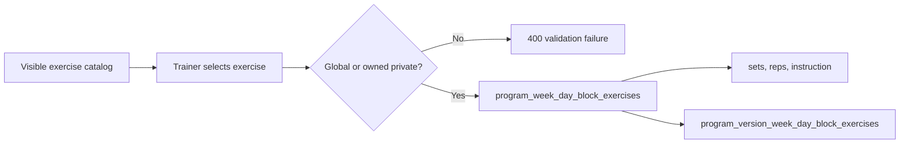
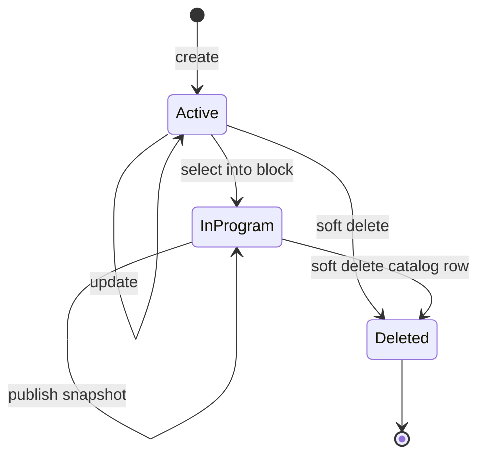

# Exercise Catalog Workflow

> **Owner:** Mentorix product owner  
> **Last updated:** 2026-10-22  
> **Verified against:** `backend` commit `6e8517e5b944a4b763a05ae65862e877870d5ae7`  
> **Use when:** changing exercise fields, catalog access, validation, quotas, or selection into a program

**Status: Implemented on stage.** This document uses persisted and API names exactly as the backend does. The HTTP contract remains [`backend/api/openapi.yaml`](../../backend/api/openapi.yaml).

## Purpose and boundary

The exercise catalog contains:

- **global** exercises, where `exercises.owner_trainer_id IS NULL`, maintained by administrators and visible to every trainer;
- **private** exercises, where `owner_trainer_id` references the owning `trainers.id`, visible and writable by that trainer and inspectable by administrators.

An exercise is reusable catalog content. Sets, repetitions, and workout instructions do not belong to `exercises`; they belong to the exercise's placement in a program block.

## Entity: `exercises`

| Database column     | Database type | Null/default                      | API field            | Rules and writer                                                                                                                                                                                     |
| ------------------- | ------------- | --------------------------------- | -------------------- | ---------------------------------------------------------------------------------------------------------------------------------------------------------------------------------------------------- |
| `id`                | `uuid`        | PK, `gen_random_uuid()`           | `id`                 | Immutable.                                                                                                                                                                                           |
| `name`              | `text`        | NOT NULL, `''`                    | `name`               | Required after trim; maximum 1000 Unicode characters.                                                                                                                                                |
| `name_ru`           | `text`        | NOT NULL, `''`                    | `name_ru`            | Optional content; maximum 1000 Unicode characters.                                                                                                                                                   |
| `exercise_type`     | `text`        | NOT NULL, CHECK                   | `type`               | Required enum. The DB name intentionally differs from the API name.                                                                                                                                  |
| `muscle_group`      | `text`        | NOT NULL, CHECK                   | `muscle_group`       | Required enum.                                                                                                                                                                                       |
| `equipment`         | `text`        | NULL, CHECK                       | `equipment`          | Optional enum; `null` means no equipment.                                                                                                                                                            |
| `difficulty`        | `text`        | NOT NULL, CHECK                   | `difficulty`         | Required enum.                                                                                                                                                                                       |
| `description`       | `text`        | NOT NULL, `''`                    | `description`        | Maximum 5000 Unicode characters.                                                                                                                                                                     |
| `description_ru`    | `text`        | NOT NULL, `''`                    | `description_ru`     | Maximum 5000 Unicode characters.                                                                                                                                                                     |
| `video_url`         | `text`        | NOT NULL, `''`                    | `video_url`          | Empty or HTTPS YouTube URL. Accepted hostnames are `youtu.be`, `www.youtu.be`, `youtube.com`, `www.youtube.com`, and `m.youtube.com`; accepted YouTube routes are watch, embed, shorts, v, and live. |
| `preview_image_url` | `text`        | NOT NULL, `''`                    | `preview_image_url`  | Optional content; no domain-specific validation.                                                                                                                                                     |
| `owner_trainer_id`  | `uuid`        | NULL, FK `trainers.id`, RESTRICT  | not exposed directly | `NULL` for global; set once to the creating trainer for private.                                                                                                                                     |
| derived             | n/a           | n/a                               | `scope`              | `global` when owner is null, otherwise `private`.                                                                                                                                                    |
| derived             | n/a           | n/a                               | `owner_user_id`      | Owning trainer's `users.id`; null for global. Do not confuse it with `owner_trainer_id`.                                                                                                             |
| `created_by`        | `uuid`        | NOT NULL, FK `users.id`, RESTRICT | `created_by`         | Calling user at create time.                                                                                                                                                                         |
| derived             | n/a           | n/a                               | `created_by_name`    | Joined from the creator's display name.                                                                                                                                                              |
| `modified_by`       | `uuid`        | NOT NULL, FK `users.id`, RESTRICT | `modified_by`        | Calling user on create and update/delete audit writes.                                                                                                                                               |
| `created_at`        | `timestamptz` | NOT NULL, `now()`                 | `created_at`         | Server time.                                                                                                                                                                                         |
| `modified_at`       | `timestamptz` | NOT NULL, `now()`                 | `modified_at`        | Updated on mutation.                                                                                                                                                                                 |
| `deleted_at`        | `timestamptz` | NULL                              | not returned         | Soft-delete marker. Catalog reads exclude deleted rows.                                                                                                                                              |

Character limits are counted as Unicode code points by Go, not bytes.

## Enumerations

| Type                             | Values                                                                                                                                                                                                                                                                       |
| -------------------------------- | ---------------------------------------------------------------------------------------------------------------------------------------------------------------------------------------------------------------------------------------------------------------------------- |
| `ExerciseType` / `exercise_type` | `strength`, `cardio`, `mixed_modal`, `intervals`, `stretching`, `metcon`, `skill_work`, `accessory`                                                                                                                                                                          |
| `MuscleGroup`                    | `compound`, `chest`, `back`, `legs`, `shoulders`, `arms`, `core`, `full_body`                                                                                                                                                                                                |
| `Equipment`                      | `barbell`, `dumbbells`, `kettlebell`, `pull_up_bar`, `squat_rack`, `rowing_machine`, `assault_bike`, `bike_erg`, `ski_erg`, `jump_rope`, `plyo_box`, `medicine_ball`, `wall_ball`, `resistance_bands`, `battle_ropes`, `gymnastic_rings`, `sandbag`, `sled`, `weight_plates` |
| `Difficulty`                     | `beginner`, `intermediate`, `advanced`, `expert`                                                                                                                                                                                                                             |
| `Scope`                          | `global`, `private`                                                                                                                                                                                                                                                          |

## Access and ownership

| Actor            | List/get                | Create                        | Update                              | Delete                      |
| ---------------- | ----------------------- | ----------------------------- | ----------------------------------- | --------------------------- |
| Trainer          | Global plus own private | Own private; subject to quota | Own private; mutation quota applies | Own private; always allowed |
| Administrator    | All global and private  | Global                        | Global                              | Global; always allowed      |
| Client-only user | No endpoint access      | No                            | No                                  | No                          |

The `/exercises` route group requires a trainer or administrator role. The service then applies ownership. A trainer asking for another trainer's private exercise receives the same not-found result as a missing row.

## HTTP workflow

| Method and path       | Behaviour                                                                                                                                                                              |
| --------------------- | -------------------------------------------------------------------------------------------------------------------------------------------------------------------------------------- |
| `GET /exercises`      | Paginated catalog. Filters: `q`, `type`, `muscle_group`, `difficulty`, `equipment`, and `scope`; `equipment=none` selects null equipment. Search uses `ILIKE` on `name` and `name_ru`. |
| `GET /exercises/{id}` | Returns one visible non-deleted exercise; invalid UUID is 400, invisible/missing is 404.                                                                                               |
| `POST /exercises`     | Creates global for admin or private for trainer; trainer quota failure is `409 quota_exceeded`.                                                                                        |
| `PUT /exercises/{id}` | Complete upsert payload. Trainer can update own private; admin can update global.                                                                                                      |
| `DELETE /exercises`   | Idempotent batch soft-delete with `{ids: uuid[]}`; duplicate IDs are deduplicated and response is `{deleted_count}`. Each caller can delete only within their ownership scope.         |

List pagination defaults are page 1 and limit 20; limit is at most 100 and page over 100000 is rejected. Sorting supports catalog fields defined by OpenAPI and always uses a stable ID tie-breaker.

## Quotas

Only non-deleted private exercises count toward the trainer's exercise usage.

| Plan      | Own exercises |
| --------- | ------------: |
| `free`    |            10 |
| `advance` |            50 |
| `elite`   |     Unlimited |

- Create is blocked when `usage >= limit`.
- Update is blocked only when `usage > limit`, producing read-only-after-downgrade behaviour.
- Delete is always allowed because it reduces usage.
- Global exercises do not count.
- The store locks the trainer and checks quota inside the write transaction.

## Program relationship

`program_week_day_block_exercises.exercise_id` and its frozen-version counterpart reference `exercises.id` with `ON DELETE RESTRICT`. Mentorix therefore soft-deletes catalog rows instead of physically deleting them. Existing program placements remain readable after soft deletion, but a deleted exercise cannot be selected for a new or replacement placement.

Ownership is checked when an exercise is added to a program or replaces an existing placement. Existing links are grandfathered: changing catalog ownership rules does not invalidate an already-linked program.

## Lifecycle

Soft delete hides the catalog row but does not erase historical or current program placements. There is no restore endpoint.

## Product surfaces

- Dashboard: trainer catalog and forms are under [`dashboard/src/entities/exercise`](../../dashboard/src/entities/exercise), [`dashboard/src/widgets/Exercises`](../../dashboard/src/widgets/Exercises), and [`dashboard/src/views/ExercisesView`](../../dashboard/src/views/ExercisesView). Calls go through the BFF.
- Program builder: exercise selectors feed placement operations under [`dashboard/src/entities/program`](../../dashboard/src/entities/program).
- Telegram: displays exercises only as part of a client's assigned frozen program; it does not manage the catalog.
- Mobile: no standalone exercise catalog or management implementation was found under [`mobile/lib`](../../mobile/lib) at the verified commit.

## Invariants for changes

1. Keep DB `exercise_type` mapped to API `type`.
2. Never expose another trainer's private exercise to a trainer.
3. Preserve soft-deleted rows referenced by working or version trees.
4. Keep prescription fields out of the reusable catalog.
5. Update the DB CHECK, Go constants, OpenAPI enum, dashboard options, and this document together when adding an enum value.

## Known contract drift

OpenAPI summaries currently call `PUT /exercises/{id}` and `DELETE /exercises` “admin only”. The mounted handler group and service implement trainer-or-admin access with ownership scoping, and repository feature documentation agrees with the service. Treat the summary text as stale; changing the external contract should be handled separately.

## Sources

- [`backend/internal/exercise/model.go`](../../backend/internal/exercise/model.go)
- [`backend/internal/exercise/service.go`](../../backend/internal/exercise/service.go)
- [`backend/internal/exercise/store.go`](../../backend/internal/exercise/store.go)
- [`backend/docs/features/exercises.md`](../../backend/docs/features/exercises.md)
- [`backend/docs/features/subscriptions.md`](../../backend/docs/features/subscriptions.md)
