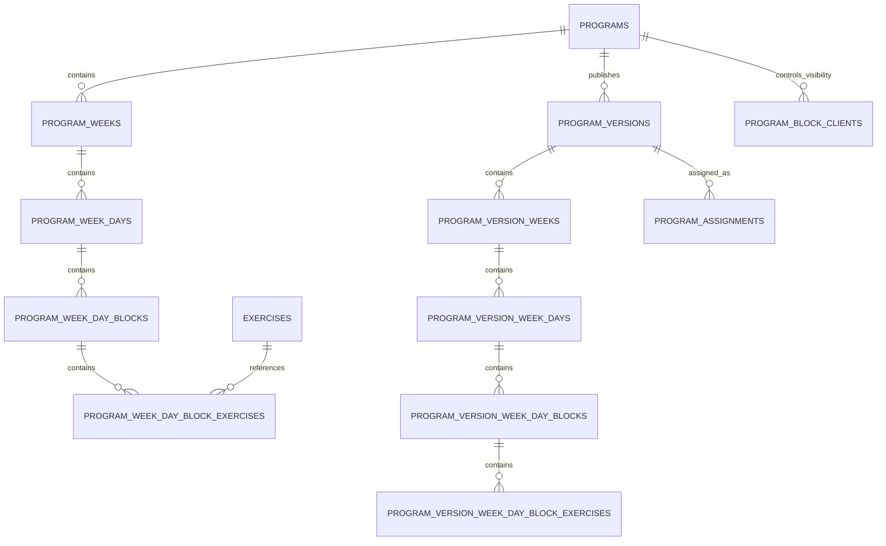
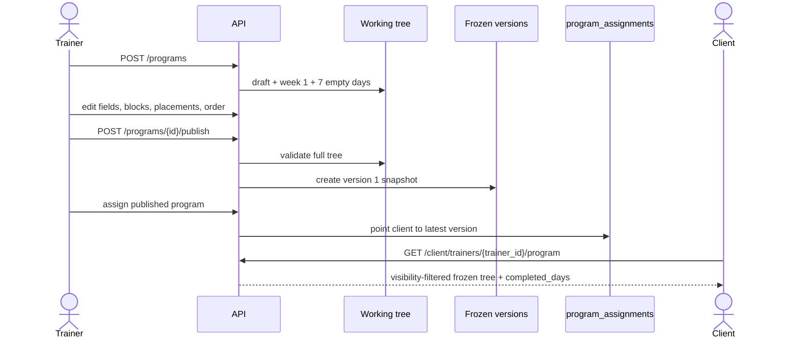
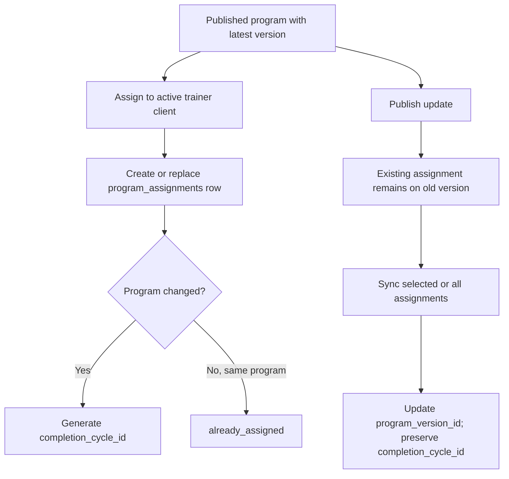

# Program Authoring and Assignment Workflow

> **Owner:** Mentorix product owner  
> **Last updated:** 2026-10-22  
> **Verified against:** `backend` commit `6e8517e5b944a4b763a05ae65862e877870d5ae7`  
> **Use when:** changing program structure, blocks, publishing, versions, client assignment, or exercise placement

**Status: Implemented on stage.** Programs have an editable working tree and immutable published versions. Clients consume only an assigned frozen version.

## Domain model

## Program fields

### `programs`

| Column                          | Type and persistence         | API field                                            | Rule                                                                                            |
| ------------------------------- | ---------------------------- | ---------------------------------------------------- | ----------------------------------------------------------------------------------------------- |
| `id`                            | UUID PK                      | `id`                                                 | Immutable.                                                                                      |
| `created_by`                    | UUID FK `users.id`, RESTRICT | `created_by`                                         | Owner user. Administrator reads do not transfer ownership.                                      |
| derived creator name            | joined                       | `created_by_name`                                    | Display only.                                                                                   |
| `modified_by`                   | UUID FK `users.id`, RESTRICT | `modified_by`                                        | Last actor.                                                                                     |
| `status`                        | text, default `draft`, CHECK | `status`                                             | `draft`, `published`, or `archived`.                                                            |
| `name`, `name_ru`               | text, NOT NULL, `''`         | same                                                 | Maximum 1000 characters each; `name` must be non-empty to publish.                              |
| `description`, `description_ru` | text, NOT NULL, `''`         | same                                                 | Maximum 5000 characters each.                                                                   |
| `category`                      | nullable text, CHECK         | `category`                                           | `weight_loss`, `muscle_gain`, `rehabilitation`, `endurance`, `functional`. Required to publish. |
| `difficulty`                    | nullable text, CHECK         | `difficulty`                                         | `beginner`, `intermediate`, `advanced`, `expert`. Required to publish.                          |
| `preview_image_url`             | text, NOT NULL, `''`         | same                                                 | Optional content.                                                                               |
| `created_at`, `modified_at`     | timestamptz                  | same                                                 | Server audit times.                                                                             |
| `deleted_at`                    | nullable timestamptz         | `deleted_at`                                         | Soft-delete marker.                                                                             |
| derived                         | n/a                          | `latest_program_version_id`, `latest_client_plan_at` | Null until first publish.                                                                       |
| derived                         | n/a                          | `has_unpublished_changes`                            | Working tree fingerprint differs from latest version.                                           |
| derived                         | n/a                          | `assignment_count`                                   | Active assignments on the program.                                                              |
| derived                         | n/a                          | `training_days_count`                                | Days with at least one block; empty days do not count.                                          |

### Editable structure

| Table                              | Fields                                                                                                                                    | Constraints and meaning                                                                                                                         |
| ---------------------------------- | ----------------------------------------------------------------------------------------------------------------------------------------- | ----------------------------------------------------------------------------------------------------------------------------------------------- |
| `program_weeks`                    | `id`, `program_id`, `week_number`, `sort_order`, `created_at`, `modified_at`, `modified_by`                                               | Unique `(program_id, week_number)`. A program has at least one week.                                                                            |
| `program_week_days`                | `id`, `week_id`, `program_id`, `day_number`, `sort_order`, `day_key`, `created_at`, `modified_at`, `modified_by`                          | Unique `(week_id, day_number)` and `(program_id, day_key)`; at most 7 days per week and at least one day. `day_key` is stable logical identity. |
| `program_week_day_blocks`          | `id`, `program_week_day_id`, `block_type`, `instruction`, `sort_order`, `block_key`, `created_at`, `modified_at`, `modified_by`           | Ordered blocks. `block_key` is stable across publish/discard. Block instruction max 5000 characters.                                            |
| `program_week_day_block_exercises` | `id`, `program_week_day_block_id`, `exercise_id`, `sort_order`, `sets`, `reps`, `instruction`, `created_at`, `modified_at`, `modified_by` | Placement of a catalog exercise. `exercise_id` uses RESTRICT. Instruction max 5000.                                                             |

`sets` and `reps` are nullable strings matching `^[0-9]+([/-][0-9]+)?$`, for example `3`, `5/4`, or `8-12`. There is no current prescription field for weight, duration, distance, tempo, rest, RPE, or timer settings. `weight_kg` was removed by migration `000014_program_day_blocks`.

All sibling `sort_order` values are normalized to `1..N` after create, move, reorder, delete, merge, ungroup, and extract. Reorder requests must provide the complete sibling ID list exactly once.

### Block types

`single`, `emom`, `amrap`, `for_time`, `intervals`, `chipper`, `ladder`, `death_by`, `superset`, `complex`, `skill_work`, `strength`, `conditioning`, `gymnastics`, `weightlifting`.

- `single` has exactly one exercise when published.
- A group is any other block type and has at least one exercise when published.
- Groups are created by merging at least two blocks; patching a `single` into a group is not allowed.
- Ungroup creates one `single` per exercise.
- Removing the exercise from a `single` removes the block. A group may temporarily contain zero or one exercise while editing, but cannot publish empty.

### Frozen versions

`program_versions` stores `program_id`, sequential `version_number`, `published_at`, `published_by`, the program's content fields, `created_at`, and `content_fingerprint`. Its immutable mirror is:

- `program_version_weeks`;
- `program_version_week_days`, including copied `day_key`;
- `program_version_week_day_blocks`, including copied `block_key`;
- `program_version_week_day_block_exercises`.

Version exercise rows still reference `exercises.id`, so soft deletion preserves existing version output.

### `program_assignments`

| Column                                     | Rule                                                                                                          |
| ------------------------------------------ | ------------------------------------------------------------------------------------------------------------- |
| `id`                                       | UUID PK.                                                                                                      |
| `program_id`                               | FK `programs.id`, RESTRICT.                                                                                   |
| `program_version_id`                       | FK `program_versions.id`, RESTRICT; the version the client currently consumes.                                |
| `trainer_id`                               | FK `trainers.id`, RESTRICT.                                                                                   |
| `client_user_id`                           | FK `users.id`, RESTRICT.                                                                                      |
| `status`                                   | Always `active`; one row exists per `(trainer_id, client_user_id)`. Clearing deletes the row.                 |
| `completion_cycle_id`                      | UUID used by completion uniqueness. It survives a version sync and changes when the assigned program changes. |
| `assigned_at`, `created_at`, `modified_at` | Audit timestamps.                                                                                             |
| `created_by`, `modified_by`                | User audit FKs.                                                                                               |

### `program_block_clients`

Rows contain `program_id`, stable `block_key`, `client_user_id`, `created_at`, and `created_by`, unique by `(program_id, block_key, client_user_id)`.

- No rows for a block means visible to every assigned client.
- A non-empty client set means visible only to those clients.
- Visibility is resolved at read time across all versions and changes without publish or assignment sync.
- A workout day containing the block being restricted must retain at least one shared block in the working copy, the latest version, and versions with active assignments. Rest days with no blocks are unaffected.
- Only clients actively assigned to this program may be selected.

## Roles, ownership, and quota

- A trainer reads and mutates only programs where `created_by` is their user ID.
- An administrator may read all programs but is read-only; mutation by a non-owner is 403.
- Clients do not access `/programs`; they use the client program endpoint.
- Active program usage counts non-deleted `draft` plus `published` programs. Limits are `free=3`, `advance=15`, `elite=unlimited`.
- Create and republish from archive use create quota; edits use mutation quota. Archive, delete, and clearing an assignment are always allowed.

## Authoring flow

### Creation and editing

`POST /programs` creates a `draft` with an empty name, week 1, and seven empty days. Structure operations add/delete/reorder weeks and days; add, merge, patch, ungroup, move, or reorder blocks; and add, update, delete, extract, move, or reorder block exercises.

Program fields use `PATCH /programs/{id}`. A selected exercise must be global or owned by the program's trainer and not soft-deleted.

### Publish and update

First publish requires valid program metadata, at least one week, and valid non-empty workout blocks. It changes `draft` to `published` and creates version 1.

Editing a published program changes only its working copy. `has_unpublished_changes` becomes true. `POST /programs/{id}/publish-update` creates the next version; existing assignments remain on their old versions until explicitly synced. `discard-unpublished` rebuilds the working tree from the latest version, preserving `day_key` and `block_key` while generating new row IDs.

Archive makes the working copy read-only. Publishing an archived program changes status without creating a new version. There is no `published` to `draft` transition.

### Assignment and sync

Assignment requires an active, non-blocked trainer-client relationship and a published program. Reassignment deletes the client's visibility rows for the previous program. Clearing deletes the assignment. Program deletion removes assignments and soft-deletes the program in one transaction.

Sync can target explicit assignment IDs or all active assignments. After updating assignments, the store attempts best-effort cleanup of unused old versions; the service then enqueues best-effort Telegram update notifications. The latest, sole, or assigned version cannot be manually deleted.

## Client representation

`GET /client/trainers/{trainer_id}/program` returns:

- trainer identity;
- assignment IDs: `assignment_id`, `program_id`, `program_version_id`, `completion_cycle_id`;
- frozen program metadata and week/day/block/exercise tree;
- `day_key` for completion tracking;
- blocks filtered by `program_block_clients`;
- `completed_days` from the current completion cycle.

The current client tree reuses the backend `Week`, `Day`, `DayBlock`, and `DayExercise` DTOs, so nested row `id` and `created_at` fields are still serialized. `block_key` is internal and is not serialized; visibility lists are sanitized so a restricted block names only the calling client. Days with no blocks are rest days and do not count as training days.

## Endpoint groups

| Area            | Endpoints                                                                                                     |
| --------------- | ------------------------------------------------------------------------------------------------------------- |
| Program         | `GET/POST /programs`, `GET/PATCH/DELETE /programs/{id}`                                                       |
| Status/version  | `publish`, `publish-update`, `discard-unpublished`, `archive`, `versions`, `versions/cleanup`, delete version |
| Assignment      | program assignments list/sync; trainer client program assignment get/set/clear                                |
| Weeks/days      | add, delete, and complete-list reorder endpoints                                                              |
| Blocks          | create single, merge, patch group, delete group, ungroup, move, reorder, set clients                          |
| Block exercises | add, update, delete, extract, move, complete-list reorder                                                     |
| Client          | `GET /client/trainers`, `GET /client/trainers/{trainer_id}/program`, completion and analytics endpoints       |

Exact paths and bodies are defined in OpenAPI under `/programs`, `/trainer/clients`, and `/client/trainers`.

## Product surfaces and notifications

- Dashboard program list, basics, structure, assignment, and version APIs live under [`dashboard/src/entities/program`](../../dashboard/src/entities/program), with views under [`dashboard/src/views`](../../dashboard/src/views).
- Telegram renders the visibility-filtered assigned version by week and day, allows completion, and receives best-effort notifications for assignment, version sync, and trainer comments.
- Mobile has authentication and trainer-linking foundations, but no complete program/workout UI was found under [`mobile/lib`](../../mobile/lib) at the verified commit.
- The notification queue is best-effort; the program and completion records remain the source of truth.

## Implemented versus future

**Implemented on stage:** text prescriptions (`sets`, `reps`, `instruction`), frozen versions, assignments, visibility, text completion results, and analytics.

**Approved direction:** structured prescriptions/results for weight, duration, distance, rest, perceived effort, timers, and offline operation IDs. These fields do not exist today and must be designed consistently in working trees, frozen versions, completion snapshots, OpenAPI, analytics, dashboard, and mobile.

## Invariants for changes

1. Never expose the working tree to a client.
2. Preserve `day_key` and `block_key` when copying or restoring logical content.
3. Preserve `completion_cycle_id` on version sync; replace it when changing program.
4. Keep reorder operations complete and transactional.
5. Apply visibility using `block_key` at read time, not a version row ID.
6. Snapshot new fields into `program_versions` before relying on them in client history.

## Sources

- [`backend/internal/program`](../../backend/internal/program)
- [`backend/docs/features/programs.md`](../../backend/docs/features/programs.md)
- [`backend/docs/features/program-blocks.md`](../../backend/docs/features/program-blocks.md)
- [`backend/docs/features/program-block-visibility.md`](../../backend/docs/features/program-block-visibility.md)
- [`backend/docs/features/trainer-clients.md`](../../backend/docs/features/trainer-clients.md)
- [`backend/docs/features/client-app.md`](../../backend/docs/features/client-app.md)
